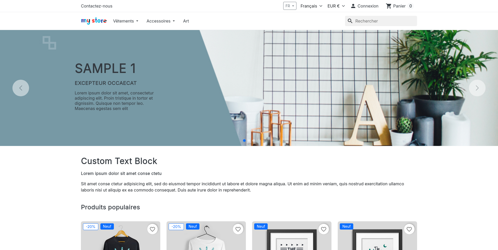
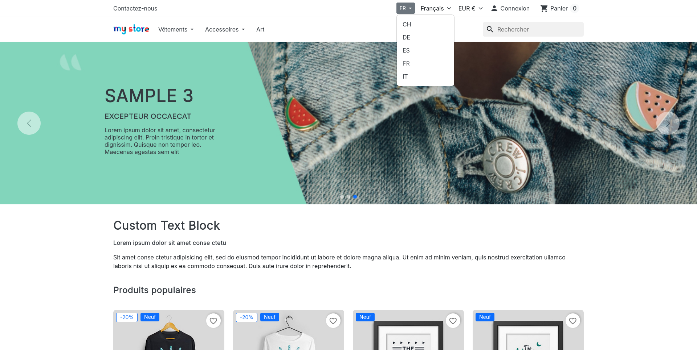

# PrestaShop Multistore Switcher

A simple, lightweight module that adds a store selector dropdown for PrestaShop multistore setups.

## Features
- Shows a dropdown of all active shops.
- Switch between stores with one click.
- No database changes.
- Free and open source.

## Screenshots

##  Manual installation
1. Upload the `multistoreswitcher` folder to your `/modules/` directory.
2. Go to Module Manager in your Back Office.
3. Search for "Multistore Switcher" and install it.
4. It will appear in the top navigation (via `displayNav2` hook). If you prefer, it can hooked to `displayFooter` too.

## Compatibility
- Works on PrestaShop 9.
- Works with Hummingbird and classic themes.

## Mobile navigation
The `displayNav2` selector appears next to the language selector in the mobile
menu of Hummingbird and Classic. Mobile uses a native store select; desktop
keeps the dropdown. The selector moves back when the viewport reaches 768px.
Other hook placements keep their dropdown.

## Browser regression tests
Use Node.js with `npm ci`, then `npx playwright install chromium`, or set
`CHROME_PATH` to an existing Chrome/Chromium executable. Run `npm run test:browser`
against a development PrestaShop instance at `SHOP_URL` (default port 8080).
The fixture must have two active shops with working URLs, English and French
enabled in both shops, and this module installed in `displayNav2` and
`displayHeader`. Run once with Hummingbird and once with Classic enabled.

The tests check desktop navigation, mobile widths of 320/390/767px, actual shop
and language changes, and repeated mobile/desktop resizing. Screenshots are
written to `test-results/` or `ARTIFACT_DIR`.

## License
Creative Commons Zero v1.0 Universal.
